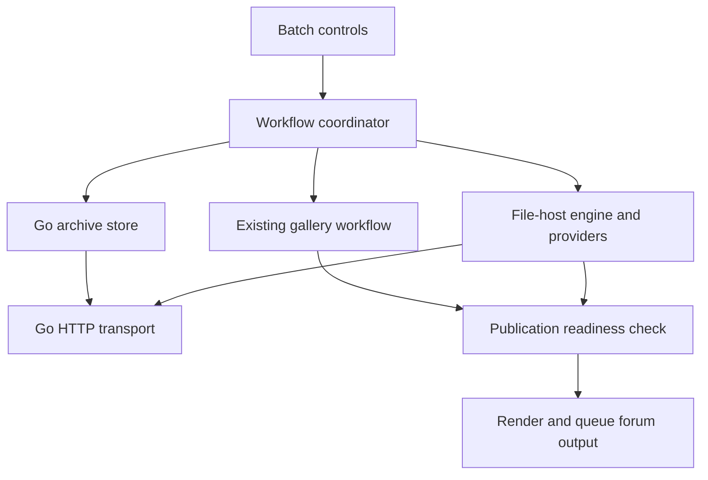

# RAM-First Archives and File-Host Uploads: Implementation Plan

Status: **Proposed implementation; no runtime behavior is implemented by this document.**

Created: 2026-11-03  
Repository: conniecombs/ConniesUploader  
Reviewed baseline: [main at 66511b3e63b2333cd7e59856eaf89164f6d852fd](https://github.com/conniecombs/ConniesUploader/commit/66511b3e63b2333cd7e59856eaf89164f6d852fd)  
Initial provider: Rapidgator  
Platforms: Windows, Linux, and macOS, preserving the existing supported desktop packaging targets.

## Contents

- [1. Objective and agreed decisions](#1-objective-and-agreed-decisions)
- [2. Scope and defaults](#2-scope-and-defaults)
- [3. Current repository baseline and required integration work](#3-current-repository-baseline-and-required-integration-work)
- [4. Architecture and ownership](#4-architecture-and-ownership)
- [5. Batch model and source identity](#5-batch-model-and-source-identity)
- [6. File-host provider contract](#6-file-host-provider-contract)
- [7. RAM archive storage and memory admission](#7-ram-archive-storage-and-memory-admission)
- [8. ZIP production, hashing, and disk mode](#8-zip-production-hashing-and-disk-mode)
- [9. Sidecar protocol and generic transport changes](#9-sidecar-protocol-and-generic-transport-changes)
- [10. Rapidgator provider workflow](#10-rapidgator-provider-workflow)
- [11. Workflow state machine and publication readiness](#11-workflow-state-machine-and-publication-readiness)
- [12. Persistence and restart recovery](#12-persistence-and-restart-recovery)
- [13. UI and settings specification](#13-ui-and-settings-specification)
- [14. Templates, output, and preview consistency](#14-templates-output-and-preview-consistency)
- [15. Planned file-level changes](#15-planned-file-level-changes)
- [16. Implementation milestones and dependency order](#16-implementation-milestones-and-dependency-order)
- [17. Test strategy and acceptance matrix](#17-test-strategy-and-acceptance-matrix)
- [18. Rollout, compatibility, and rollback](#18-rollout-compatibility-and-rollback)
- [19. Risks and decisions to resolve during implementation](#19-risks-and-decisions-to-resolve-during-implementation)
- [20. Definition of done](#20-definition-of-done)
- [21. Sources and verification notes](#21-sources-and-verification-notes)

## 1. Objective and agreed decisions

Allow each image batch to produce a downloadable ZIP of its original images, upload that ZIP to a file host, and place verified download links alongside the gallery in generated output and forum posts.

The agreed architecture is one integrated application with a reusable, GUI-independent file-host engine. Python owns providers and workflow decisions. The existing Go sidecar owns the archive bytes and generic transport. Adding a host should normally mean adding a Python provider, its settings, fixtures, and packaging registration.

The following decisions supersede the initial disk-backed archive proposal:

1. ZIP creation is RAM-first. No ordinary ZIP, partial archive, or temporary archive file may be created unless the user explicitly selects **Create ZIP on disk**.
2. That checkbox is unchecked by default. Selecting it enables a destination-folder selector. Memory pressure must never silently check it or choose a disk destination.
3. Normal OS-managed paging is permitted as the backup to pageable memory. The system file cache is not a second pool of memory.
4. The app must not claim that archive bytes can never reach physical storage: the OS may page them or include process memory in system dumps. The application-level guarantee concerns archive files created by ConniesUploader.
5. Go creates, hashes, retains, and streams the archive. Python receives an archive handle and metadata, not the ZIP payload.
6. Rapidgator is the first provider. The contracts and result model must accommodate additional providers and multiple mirrors of one archive.
7. The posting workflow waits for the gallery and all required archive results. Retrying an archive or a forum post must not re-upload successful images.
8. Persistent recovery records may contain metadata and links, but never RAM archive contents. A lost RAM archive is rebuilt from unchanged originals when still needed.
9. This change remains optional. With archive uploading disabled, existing image-only behavior and custom template output remain compatible.
10. This document authorizes no live upload, account mutation, or forum post. Implementation and live validation are later work.

### Success scenario

A user adds three image folders, chooses IMX for galleries, enables downloadable ZIPs, selects Rapidgator, and leaves disk storage unchecked. Each successful batch is archived in memory, uploaded, verified, and rendered with its gallery and Rapidgator link. The UI stays responsive. If batch two's archive transfer fails, batch one's completed work is retained, batch two can retry only its archive, and batch three is not permanently trapped behind an unhandled queue index.

## 2. Scope and defaults

| Area | Initial implementation |
| --- | --- |
| Gallery services | Continue using existing image-host plugins and gallery workflows |
| File hosts | Rapidgator provider; capability-based interface and multi-result storage from day one |
| Archive contents | Exact accepted original files in the batch, including covers |
| Archive format | ZIP with ZIP64 support; stored entries by default |
| Compression | Stored entries in the first milestone; optional Deflate after memory and CPU validation |
| Storage | Pageable memory by default; disk only through an explicit checkbox |
| Resident archives | One archive being built, retained for retry, or uploaded at a time |
| Archive transfers | One initially; always limited by provider/account and application budgets |
| Output | BBCode, Markdown, HTML, clipboard, saved output, history, and ViperGirls posting |
| Posting policy | Every selected provider is required in the first UI; no implicit partial-success post |
| Archive retry | Reuse the same live archive where possible; reconcile remote status before retransmission |
| Restart | Recover metadata and remote results; rebuild a lost RAM archive only when necessary |
| File splitting | Excluded initially; oversize archives receive an actionable error |
| Encryption/password ZIPs | Excluded initially |
| Remote import/FTP/browser automation | Excluded from the Rapidgator MVP |
| Standalone program | Excluded initially; keep the engine independent of Tkinter for a future CLI |
| New always-running service | Not required |
| Implementation location | Existing Python frontend and bundled Go sidecar; no second upload executable |

An additional host can initially be selected in a later UI milestone without changing the archive model. Required/optional mirror policies can be added after the all-selected-hosts-required behavior is proven.

## 3. Current repository baseline and required integration work

The reviewed code is the authority for these observations. File references below are relative to this plan.

| Existing area | Observed behavior | Planned work |
| --- | --- | --- |
| [UploadManager](../../frontend/modules/upload_manager.py) | Prepares galleries, dispatches image jobs, handles image results | Preserve it as the image engine; expose batch events and source fingerprints to the coordinator |
| [Active runtime mixin](../../frontend/modules/ui/Main_Window/runtime.py) | Marks a group complete and generates output after image results arrive | Separate image completion from whole-workflow readiness |
| [AutoPoster](../../frontend/modules/auto_poster.py) | Uses an image-upload callback and ordered batch indexes | Add explicit readiness and terminal/skipped states; keep the worker alive for pending archive work |
| [Gallery actions](../../frontend/modules/ui/Main_Window/gallery_actions.py) | Tracks gallery selection and Pixhost finalization | Report successful or failed finalization to the coordinator before publication |
| [SidecarBridge](../../frontend/modules/sidecar.py) | Broadcasts events; synchronous helper returns the first matching-ID event | Add owned subscriptions and terminal-event waiting for long-running jobs |
| [Go HTTP runner](../../backend/core/http.go) | Opens file paths, streams multipart bodies, and uses image-parser compatibility hooks | Add archive readers and bounded raw upload responses without host logic in Go |
| [Go validation](../../backend/core/validate.go) | Upload validation requires paths and applies a 100 MiB per-file limit | Separate image-path validation from archive-source validation; preserve existing image safeguards |
| [Go types](../../backend/core/types.go) and [handlers](../../backend/handlers.go) | A 180-second client/context limit is used for uploads | Introduce coordinated per-job deadlines and upload-idle timeout handling |
| [TemplateManager](../../frontend/modules/template_manager.py) | Allows a defined set of placeholders and image/cover loops | Add archive placeholders, validation, rendering, and preview fixtures |
| [CredentialsManager](../../frontend/modules/credentials_manager.py) | Loads existing service credentials into the OS keyring workflow | Add file-host credential descriptors and transient 2FA prompts |
| [App startup](../../frontend/modules/ui/Main_Window/app.py) | Instantiates upload, posting, and scheduled-post services | Instantiate the coordinator and reconcile unfinished archive jobs |
| [Transport contract](../TRANSPORT_CONTRACT.md) | Python owns website decisions; Go owns generic transport | Explicitly extend Go ownership to generic archive storage, ZIP generation, and hashing |
| [Go module](../../backend/go.mod) | Declares Go 1.26.0 at this baseline | Use the actual module/CI toolchain; do not infer it from older README version text |

Additional details that affect implementation:

- IMX automatic gallery creation uploads its first image during preparation. That completed image must remain in the archive manifest without being uploaded twice.
- Pixhost gallery finalization is distinct from individual image upload completion.
- File-host results must never enter the image-result tuple list, thumbnail queue, or image completion counters.
- An upload initialization may be non-idempotent even if it uses HTTP POST for convenient parameter encoding.
- Existing progress can reach 100% of transferred bytes before the host has finished processing.
- The active GUI workflow lives in Main_Window mixins. Do not accidentally implement this only in the older controller module or duplicate orchestration across both paths.
- Documentation and contribution rules currently describe Go as transport-only. Update those rules alongside the generic archive implementation, rather than introducing host behavior into Go.

## 4. Architecture and ownership

### 4.1 Components

| Component | Owner | Responsibilities |
| --- | --- | --- |
| BatchWorkflowCoordinator | Python | Stable batch identity, stage transitions, readiness, retry decisions, output gating |
| FileHostEngine | Python | Provider execution, authentication/session coordination, retries, verification |
| FileHostProvider | Python | Account capability normalization and host-specific request/response behavior |
| RapidgatorProvider | Python | Rapidgator login, upload initialization, polling, metadata interpretation |
| JobStore | Python | Transactional metadata persistence and recovery |
| ArchiveStore | Go | Opaque archive handles, storage policy, memory accounting, reader lifetimes |
| ZIP builder | Go | Source validation, safe member names, ZIP/ZIP64 production, integrity verification |
| Transport runner | Go | HTTP execution, multipart streaming, byte progress, cancellation, timeouts |
| UI adapter | Python/Tkinter | Controls and progress rendering; all long work remains off the Tkinter thread |
| Output renderer | Python | One shared rendering path for preview, clipboard, files, history, and posting |

### 4.2 Data flow



Arrows between Python and Go carry control messages, metadata, and results. Archive payload bytes remain in the Go process and travel directly from an archive reader into the network request.

### 4.3 Architectural invariants

- Production Go code contains no Rapidgator endpoint names, login sequences, file modes, or forum-specific decisions.
- The Python provider package imports no GUI classes.
- Image and file-host providers remain separate registries with separate result types.
- Network transport is generic; provider-specific parsing stays in Python.
- A single archive can supply multiple independent readers, but the initial concurrency policy enables only one archive transfer.
- No provider can request disk fallback through a hidden default. The coordinator supplies an immutable, explicit storage policy, which Go validates.
- Releasing an archive invalidates its handle for new readers. Active readers must finish or be canceled before backing memory is unmapped.
- The GUI and Go worker have distinct memory budgets; one process's runtime setting does not cap the other.
- A future CLI should wrap the coordinator/engine and sidecar contract, not depend on Tkinter widgets or reimplement providers.

## 5. Batch model and source identity

Introduce immutable snapshots for active work. Mutable GUI group objects are not the source of truth once a batch starts.

### 5.1 Batch snapshot

A snapshot records:

- Stable batch UUID, revision, display title, ordered source manifest, and cover selection.
- Image-host identity and relevant settings.
- Selected file-host identities and per-provider configuration.
- Storage mode, explicit disk selection, destination if selected, and memory-budget policy.
- Template name plus template-content snapshot, output format, and posting target ID.
- Required providers and the publication policy.
- Creation time and an application schema version.

Changes to filenames, members, storage mode, or output-affecting settings create a new revision. A revision cannot silently reuse an incompatible archive or already-posted content.

### 5.2 Source manifest

Each entry includes source path, safe archive member name, size, modification time at nanosecond precision where available, file identity where supported, cover flag, and SHA-256 of the original bytes used by the image upload.

For archive-enabled batches, capture the source digest from the same byte stream read for the successful image upload. Cover IMX's first-image preparation path as well as generic sidecar uploads. This adds hashing only to opted-in workflows.

The archive builder checks identity/stat values before and after reading and computes each member's digest. The digest must match the recorded uploaded-source digest. Stat checks alone are insufficient to guarantee correspondence.

If a source changes, disappears, becomes unreadable, or resolves to an unsupported object:

1. Stop archive creation with a source-specific error.
2. Discard the incomplete RAM archive.
3. Preserve existing gallery results.
4. Require restoring the original or explicitly starting a new batch revision.

The ZIP contains local original bytes. An image host may transform displayed images; that does not change the original-file archive policy.

### 5.3 Member naming

- Use safe relative names with forward slashes; never absolute paths, drive letters, or parent traversal.
- Preserve relative folder structure where it is part of the selected batch.
- Resolve duplicate names deterministically, including case-insensitive collisions.
- Include cover images once.
- Reject symlinks/reparse points or handle them through an explicitly tested policy; do not follow them outside the accepted source manifest.
- Do not include app settings, credentials, generated output, previous archives, or unrelated files discovered by rescanning a folder.
- Use a sanitized batch title and stable revision suffix for the archive's external filename.
- Freeze member order and timestamps so unchanged inputs can be rebuilt reproducibly with the same implementation.

## 6. File-host provider contract

Implement a separate file-host registry under a proposed `frontend/modules/file_hosts/` package.

### 6.1 Provider operations

| Operation | Input | Output |
| --- | --- | --- |
| describe | None | Stable provider ID, display name, credential/settings schemas, capabilities |
| authenticate | Credential reference and optional transient challenge response | In-memory session and sanitized account identity |
| get_account_limits | Session | Maximum file size, free storage, allowed concurrency, access-mode options |
| prepare_upload | Session, immutable archive metadata, destination options | Upload session reference and resolved transport instruction, or completed result |
| interpret_transfer | Raw bounded HTTP response | Processing state, completed result, or normalized error |
| inspect_upload | Saved upload session reference | Pending, complete, failed, expired, or unknown |
| verify_file | Remote file ID and expected archive metadata | Verified normalized result or mismatch |
| reconcile_upload | Saved identifiers plus expected metadata | Existing result, safe-to-retry decision, or unknown-outcome state |

Exact names may be refined during implementation, but these responsibilities must remain distinct.

### 6.2 Capability descriptors

Capabilities include required checksums, upload-size limits, request-body requirements, native resume support, status polling, remote metadata lookup, access modes, and cancellation/delete support.

Do not interpret absent limits as unlimited. Unknown values must be represented explicitly and resolved or reported during preflight.

A host's native multipart/resume protocol is separate from ordinary HTTP multipart/form-data. Support is declared only after documented behavior and tests establish it.

### 6.3 Normalized results and errors

A successful archive result contains:

```json
{
  "provider_id": "rapidgator.net",
  "batch_id": "batch-uuid",
  "batch_revision": 1,
  "archive_sha256": "hex-digest",
  "remote_file_id": "remote-id",
  "share_url": "https://rapidgator.net/file/remote-id/batch.zip.html",
  "filename": "batch.zip",
  "size_bytes": 12345678,
  "access_mode": "public",
  "verified_at": "2026-11-03T12:00:00Z"
}
```

The URL above is illustrative, not a real uploaded file. Store the provider-returned URL after validation; do not synthesize IDs or links from this example.

Use structured error codes such as `auth_required`, `invalid_credentials`, `two_factor_required`, `account_storage_full`, `archive_too_large`, `memory_budget_exceeded`, `source_changed`, `insecure_upload_endpoint`, `rate_limited`, `remote_processing_timeout`, `verification_failed`, and `outcome_unknown`.

Each error also includes stage, retry classification, user action, and sanitized detail. Provider-specific text must not leak credentials or signed upload URLs.

### 6.4 Adding another provider

A new provider should require its adapter, settings/credential descriptors, response fixtures, contract tests, documentation, and packaging inclusion. It should not require changes to ZIP creation, forum rendering, or the persistent result schema.

If a new host requires a genuinely new transport primitive, add a generic capability to Go with independent tests. Avoid embedding that host's workflow in the transport layer.

## 7. RAM archive storage and memory admission

### 7.1 Storage policy

| Mode | Archive backing | Persistence |
| --- | --- | --- |
| Memory, default | Pageable anonymous memory owned by Go | Lost when the worker exits or handle is released |
| Disk, explicit checkbox | Selected directory, with a partial file followed by atomic finalization | Subject to the user's retention choice |

In memory mode, no archive bytes may be written to temporary directories, database BLOBs, recovery journals, debug dumps produced by the app, crash attachments, or hidden spool files. Small metadata records and normal application output remain permitted.

Do not use `SpooledTemporaryFile` or any equivalent automatic rollover mechanism. Do not use a disk-file mapping, RAM-disk utility, or temporary-file flag as evidence that an archive cannot reach disk.

### 7.2 Store representation

Use fixed-size segments behind a generic append writer and `io.ReaderAt` implementation. An initial segment size of 4 MiB is a benchmark starting point, not a permanent tuning guarantee.

Prefer OS-backed anonymous allocations with explicit allocation errors and release operations:

- Windows: private pageable virtual memory through a small, tested platform wrapper.
- Linux/macOS: anonymous mappings through platform wrappers.
- No named disk file is involved.
- Do not lock the entire archive into physical RAM or require administrator privileges.
- Do not expose platform handles to Python or create world-readable shared-memory objects.
- Keep the backing-store API independent of the OS implementation.

Plain Go heap chunks are an alternative only if the memory admission design is shown to be sufficient. Go heap exhaustion is not safely converted into a normal job error by a panic recovery handler. OS mapping failures are more explicit, but Unix overcommit and changing system pressure still prevent an absolute OOM guarantee.

Track all external allocations explicitly. Go's `SetMemoryLimit` is soft and excludes memory mapped outside the Go runtime; it cannot replace archive accounting.

### 7.3 Admission calculation

Before building, estimate a conservative upper bound for the final ZIP and its working set. For stored entries include source lengths, UTF-8 names, local headers, descriptors, central-directory records, extra fields, ZIP64 records, segment rounding, and verifier/transport buffers. Use checked 64-bit arithmetic.

Reserve the budget atomically before reading source bytes. A reservation includes retained archive capacity, build buffers, verification buffers, pending upload buffers, and bounded metadata. Re-check system conditions before extending backing memory.

Proposed initial defaults to calibrate with benchmarks:

- One resident archive across all batches, including failed archives retained for retry.
- An Auto budget capped at 2 GiB and 25% of currently available physical memory, further reduced by current commit/container headroom.
- Reserve at least the larger of 512 MiB or 10% of physical RAM for system headroom when evaluating available capacity.
- Provide an advanced explicit archive budget, still constrained by safe commit/container capacity.
- Do not assume a pagefile will grow or that swap is available.
- If a platform cannot report a reliable metric, use a conservative fallback and report that limitation.

On Windows derive current commit headroom from `(CommitLimit - CommitTotal) * PageSize`, subtract safety headroom, and inspect physical availability separately. Do not add system-cache size to available RAM; that would double-count memory.

On Linux account for container/cgroup limits when present, available physical memory, swap configuration, and overcommit behavior. On macOS account for memory pressure and available-memory observations. Platform probes must be implemented and verified in the relevant milestone, not inferred from Windows behavior.

### 7.4 Insufficient memory behavior

If admission fails, mark the batch `waiting_for_memory` without starting an archive. Offer retry, reduce the batch, choose a higher safe configured budget, or explicitly select disk mode.

If pressure increases during creation, stop allocating, cancel the build safely, release incomplete segments, and preserve gallery metadata. Do not hold an unusable partial archive indefinitely while waiting for memory to appear.

If a completed archive occupies the only slot during a long retry delay, offer retry now, retain while paused, or release and rebuild later. Other batches must show why they are waiting. Never silently evict an archive whose identity is needed for an active upload.

Paging is managed by the OS and may reduce performance. The UI may describe memory pressure, but must not claim to know exactly which archive pages are in physical RAM.

### 7.5 Lifetime and shutdown

The archive store keeps an opaque handle, worker-instance nonce, batch/revision owner, logical byte length, allocation size, hashes, state, and reader count.

Closing or canceling an HTTP reader releases its lease. Free/unmap storage only when no reader can access it. Repeated release requests must be harmless. Requests against an old worker instance return `archive_not_available`.

Release after all selected uploads are verified and their metadata is committed. Posting and scheduled-post retries need verified links, not retained ZIP bytes.

On cancellation or parent-process EOF, cancel active jobs and release resources. A worker crash invalidates all RAM handles, even if a platform eventually reuses an address or integer handle.

## 8. ZIP production, hashing, and disk mode

### 8.1 Memory build algorithm

1. Validate the immutable manifest, source identities, names, and memory reservation.
2. Create a segmented archive sink inside Go.
3. Use the Go `archive/zip` writer with stored members initially.
4. Stream each source with bounded buffers, calculate its source digest, and compare it to the accepted upload fingerprint.
5. Close every source promptly; check cancellation between chunks.
6. Close the ZIP writer and check its error. The central directory is part of the archive and must be present before readiness.
7. Determine final size and compute MD5 and SHA-256 over the completed archive through a bounded reader.
8. Open a ZIP reader over the same memory store, verify member names/counts/sizes, and read members to EOF to exercise CRC validation.
9. Freeze the archive as immutable and publish its metadata/handle.
10. Any failure before readiness releases the incomplete store.

Hashing during append-only generation may later remove an extra scan, but hashes are valid only after ZIP close succeeds and all emitted bytes, including final records, are included. Never hash an intermediate ZIP and upload different bytes.

ZIP64 is supported by Go's ZIP package. It does not make a host's file-size limit larger. Multi-volume/split ZIPs remain outside the MVP.

### 8.2 Reader contract

Each transfer gets an independent bounded reader with length and restart-from-zero support. Multipart construction consumes this reader without copying the complete archive into another buffer.

The initial implementation does not require cross-process shared memory, a binary IPC channel, Base64 transport, or moving ZIP bytes through Python. The existing control channel carries only the archive handle and metadata.

### 8.3 Explicit disk mode

Disk mode uses the same archive interface and integrity checks, but its backing store is a user-selected folder. It may write a uniquely named partial file, close/verify it, and atomically finalize it without overwriting unrelated files.

Requirements:

- The request must contain the explicit selected mode and a validated destination.
- Missing permission or a read-only destination is a disk-mode error, not a reason to change modes.
- Show the actual destination and retention choice.
- Delete only app-owned incomplete files according to the documented cleanup policy.
- Do not delete completed user-retained ZIPs automatically.
- Failed or restored jobs cannot enable disk mode merely because a previous destination exists.
- Keep the global default unchecked. For the first release, do not silently restore a checked disk option into a newly created batch; recovery of the exact selected batch preserves its recorded choice.

## 9. Sidecar protocol and generic transport changes

All names in this section are proposed additions, not existing commands.

### 9.1 Protocol negotiation

Add a handshake returning protocol version, worker-instance ID, and capabilities such as `archive_store_v1`, `archive_upload_source_v1`, `raw_upload_response_v1`, and `cancel_job_v1`.

If the packaged Go binary is older, disable archive controls with a clear compatibility message. Do not fall back to disk files or reinterpret an archive handle as a path.

### 9.2 Commands

| Command | Purpose |
| --- | --- |
| hello | Version/capability negotiation |
| archive_create | Build from a validated manifest and explicit storage policy |
| archive_inspect | Return metadata for a live archive handle |
| http_upload | Existing action extended with exactly one source: legacy path or archive handle |
| archive_release | Release a live archive when reader leases permit |
| cancel_job | Cancel a targeted request without killing unrelated work |
| http_request | Existing raw metadata/API request path with explicit retry and timeout policy |

Illustrative creation request:

```json
{
  "id": "request-uuid",
  "action": "archive_create",
  "service": "archive",
  "batch_id": "batch-uuid",
  "batch_revision": 1,
  "storage": {
    "mode": "memory",
    "disk_opt_in": false,
    "memory_budget_bytes": 1073741824
  },
  "archive": {
    "filename": "batch.zip",
    "compression": "store",
    "members": [
      {
        "source_path": "/absolute/path/image.jpg",
        "member_name": "image.jpg",
        "expected_size_bytes": 12345,
        "expected_sha256": "hex-digest"
      }
    ]
  }
}
```

Illustrative ready result:

```json
{
  "id": "request-uuid",
  "type": "result",
  "status": "success",
  "data": {
    "worker_instance_id": "worker-uuid",
    "archive_id": "archive-uuid",
    "batch_id": "batch-uuid",
    "batch_revision": 1,
    "storage_mode": "memory",
    "filename": "batch.zip",
    "size_bytes": 12567,
    "md5": "hex-digest",
    "sha256": "hex-digest",
    "file_count": 1
  }
}
```

Examples use placeholder identifiers and digests. Implement real schemas and validation before accepting these messages.

### 9.3 Validation and event routing

- Give every request a unique ID; bind archive handles to a worker instance and batch revision.
- Use separate event subscriptions for image jobs, archive jobs, and synchronous metadata requests.
- Acknowledgment/progress/status events are not terminal responses.
- Fix synchronous waiting so it waits for a terminal event for its own ID.
- Emit exactly one terminal outcome per request; discard late events from canceled attempts or old worker instances.
- Process cancellation control messages promptly, even when transfer worker slots are occupied.
- Preserve bounded queues, but never drop a terminal event without surfacing a transport failure.
- Validate archive sizes against provider and application policy, not the image path validator's 100 MiB limit.
- Continue validating actual source paths and regular-file identities; do not weaken image-path validation globally.
- Validate numeric sizes, member counts, handle ownership, and command payload bounds before allocation.

### 9.4 HTTP behavior

Extend upload results to expose bounded raw response bytes, HTTP status, and final URL. A proposed raw-body cap is 1 MiB, configurable per generic request within a safe application maximum. Truncation must be explicit and cannot be interpreted as successful JSON.

Support exact multipart `Content-Length` without buffering the full body. Calculate boundaries, headers, text fields, file bytes, and trailers consistently. Validate Rapidgator's actual behavior before deciding whether chunked transfer is sufficient.

Expose connect, TLS, response-header, upload-idle, and overall job timeouts. A proposed starting policy is a 120-second no-progress upload timeout and a configurable one-hour maximum archive transfer deadline. Calibrate both with slow-link tests. Do not reuse the fixed 180-second image deadline for archive uploads.

The HTTP client timeout and outer context deadline must agree. The idle watchdog should be based on observable request-body progress and must also handle a peer that stops responding after receiving the body. Body bytes consumed by the HTTP transport are not proof that the remote file is durable.

Stop transport retries from multiplying provider retries. For non-idempotent initialization or transfer calls, a lost response is an uncertain outcome that belongs to Python's reconciliation policy.

### 9.5 Logging and destination handling

Redact login/password/code/token values, signed upload query strings, cookies, and authorization headers in both normal logs and error strings. HTTP libraries may include the request URL in an error, so sanitizing only explicit log fields is insufficient.

Keep normal TLS verification enabled. Validate returned destinations and redirects before sending archive data; reject non-HTTPS destinations, loopback/private-network surprises, unexpected domains, and HTTPS downgrade redirects unless a separately reviewed provider contract explicitly requires a supported destination. Do not forward account credentials to an upload server merely because it returned a URL.

## 10. Rapidgator provider workflow

The official API documents GET and POST requests. Prefer HTTPS POST form fields for credentials and tokens so they do not appear in query strings. This does not remove the need to redact responses, upload URLs, and exception messages.

### 10.1 Authentication and account preflight

1. Obtain credentials from the existing OS keyring integration.
2. Call `/api/v2/user/login` with `login` and `password`; include transient `code` when 2FA is enabled.
3. Parse both HTTP status and the API envelope's `status`, `response`, and `details`.
4. Keep the token in memory; serialize concurrent refreshes so several batches cannot create a login storm.
5. Read account information through login data or `/api/v2/user/info`.
6. Normalize `storage.left`, `upload.max_file_size`, and `upload.nb_pipes`, including string-valued numbers.
7. Validate selected destination/access settings and estimate storage requirements before image work.
8. Recheck actual ZIP size and storage before initialization. The documentation's example numbers are not universal account limits.

Invalid passwords and invalid 2FA codes stop for user action. Never repeatedly retry them. Authentication expiry may trigger one controlled refresh; if 2FA is needed, pause the affected job.

### 10.2 Upload initialization and transfer

Call `/api/v2/file/upload` with token, filename, final size, final MD5, optional folder ID, and the selected multipart behavior.

Persist the returned upload ID before starting body transmission. Interpret states explicitly:

| State | Meaning | Action |
| --- | --- | --- |
| 0 | Uploading | Use the returned upload destination when this is a newly prepared transfer |
| 1 | Processing | Poll status; do not start a second transfer |
| 2 | Done | Validate the returned file object and proceed to verification |
| 3 | Fail | Record the host failure and classify retry eligibility |
| Unknown/malformed | Unrecognized response | Preserve evidence and stop with a protocol error |

If the host reports an instant completed upload, skip sending the body. For an ordinary upload, pass the resolved destination and multipart field `file` to Go with the archive handle.

The documentation contains HTTP example URLs. Verify real returned HTTPS support in the first live test. Do not silently rewrite an upload URL and assume the alternate endpoint works, and do not downgrade transport to HTTP.

### 10.3 Polling and verification

Poll `/api/v2/file/upload_info` using the saved upload ID after the transfer or when reconciling an uncertain outcome.

Proposed polling defaults: start at two seconds, increase to five then ten seconds, cap at fifteen seconds, add jitter, and stop at a configurable ten-minute processing deadline. Honor explicit server retry guidance. These are client starting values, not documented Rapidgator service guarantees.

Verify the resulting remote file through `/api/v2/file/info`. Compare expected size and MD5 where provided, confirm a usable share URL and intended access mode, and persist the file ID plus SHA-256 association.

The forum link is the returned file share URL. Do not use `file/download` session URLs or one-time links. Public mode is intended to make the file shareable; it does not promise unrestricted free downloads for all visitors.

A mismatch is a verification failure, not a ready link. A private or unexpectedly premium-only file must not silently be advertised as a public download.

### 10.4 Retry rules

Rapidgator requests that clients stop retrying a failed request after three tries. Use a conservative ceiling of three total attempts for one failed logical request, counted across all layers.

- Retry only classified transient failures, with backoff and jitter.
- Stop immediately on bad credentials, unsupported state, invalid source, quota, or size errors requiring user action.
- A successful status poll that reports processing is not a failed request retry; polling still has its own time/request budget.
- Do not retry an initialization blindly after a lost response. Reconcile using known upload/file references and supported metadata lookup; otherwise expose `outcome_unknown`.
- Do not treat server-side deduplication as an idempotency guarantee. The docs also describe a same-file-copy limit.
- After a transfer disconnect, inspect the existing session before retransmitting.
- No byte-offset resume is promised by the reviewed documentation. An incomplete transfer may require a new attempt from byte zero.
- If the session is unavailable and the outcome cannot be proven, preserve state for user reconciliation rather than repeatedly creating copies.

### 10.5 First live validation gate

Before enabling production use, validate with a tiny user-authorized test archive:

- Login with and without enabled 2FA, without deliberately generating repeated bad-password attempts.
- Real account limit fields and destination permissions.
- HTTPS upload destination and redirects.
- Multipart body requirements and final response shape.
- Instant completion, normal transfer, processing, verification, and access mode where the account allows testing.
- Token/session expiration behavior.
- Cancellation and ambiguous-response recovery.

No live test has been performed for this plan. Account credentials, provider-side files, and forum posts must not be created or modified merely to validate this documentation.


## 11. Workflow state machine and publication readiness

Track gallery, archive, provider upload, and publication as separate state machines. A single overloaded `is_uploading` or `group.is_completed` boolean cannot represent the new workflow.

### 11.1 Stage states

| Stage | Representative states |
| --- | --- |
| Gallery | pending, uploading, finalizing, ready, failed, canceled |
| Archive | disabled, waiting_for_memory, building, verifying, ready, unavailable, failed, released |
| Each provider | pending, authenticating, prepared, uploading, processing, verified, failed, outcome_unknown, canceled |
| Output | waiting, ready, saved, failed |
| Publication | not_requested, blocked, awaiting_confirmation, queued, posting, posted, failed, outcome_unknown, skipped |

Store stage state, attempt ID, timestamps, retry information, and a sanitized error independently. All transitions go through the coordinator and persistent store.

### 11.2 Readiness predicate

A batch can produce publishable combined output only when:

- Every required image has a usable result.
- Any required gallery finalization succeeded.
- The frozen batch revision still matches the selected content.
- Archive uploading is disabled, or every required provider has a verified result for the exact archive SHA-256 and revision.
- The intended output template can include the required links.
- The selected target and posting authorization are valid when posting is requested.

A gallery with some failed images does not silently produce a smaller archive. A partial-image workflow requires a deliberate new manifest/revision and an accurate preview.

### 11.3 Ordering and independent retries

Default order within one batch is gallery completion/finalization, archive creation, host upload/verification, output rendering, and publication. Other batches' image uploads may continue while one archive is active, subject to the memory and worker budgets.

The AutoPoster must know all relevant batch IDs and their terminal/skipped states. Do not wait forever for an integer index that will never be queued. Preserve ordering among ready eligible batches while allowing explicit failed/skipped batches to stop blocking later ones.

A blocked archive is not silently skipped for posting. It remains visible with an action. Once marked terminal failed, the post queue can advance without publishing that batch.

Retry scopes:

| Retry action | Reused work | Repeated work |
| --- | --- | --- |
| Retry failed image | Successful image results and compatible gallery context | Only the failed image work; rebuild archive only if required content changes |
| Retry archive build | Gallery results and immutable source manifest | Archive build/verification |
| Retry host upload | Live archive and successful provider results | Reconciliation and the failed provider's work |
| Retry output save | Verified gallery and archive metadata | Rendering/save only |
| Retry forum post | Final rendered post and verified links | Posting after duplicate-outcome checks |

Retain a failed archive during automatic retry attempts. After the retry budget ends, release it by default once all readers close so other batches can proceed; mark that a future manual retry may rebuild. An explicit retain-and-pause option may keep it, with the queue impact shown.

### 11.4 Posting idempotency and uncertain outcomes

Use a publication identity derived from batch revision, target ID, rendered-content hash, and publication purpose. Persist a posting intent transaction before the network call, then record the returned post ID/URL when available.

A timeout after submitting a forum request does not prove the post failed. Mark it `outcome_unknown` and reconcile with available forum history or require review. Do not claim exactly-once posting when the forum offers no idempotency guarantee.

Once posted, editing a template or adding a mirror creates a new output revision. Automatic editing or reposting of the existing forum post is out of scope.

### 11.5 Scheduled posts

Persist the final rendered text and verified link metadata before creating a ready scheduled post. A due time cannot bypass readiness.

If supporting a schedule before uploads finish, represent it as `waiting_for_assets`, not as a normal ready post containing placeholders. If the due time passes, retain a blocked status and request the applicable user decision instead of silently posting incomplete text.

Before a later scheduled publication, revalidate known archive availability where the provider supports it. Missing links block publication; they do not automatically authorize rebuilding and re-uploading without the established job policy.

## 12. Persistence and restart recovery

### 12.1 Proposed store

Add `~/.conniesuploader/archive_jobs.sqlite3` using Python's standard-library SQLite support. This store contains metadata only. Use a single writer queue, transactions, schema versioning, foreign keys, and a bounded busy timeout; select and test the journal mode during implementation.

The existing settings, gallery cache, output history, posting history, and scheduled-post stores remain compatible. Record cross-references instead of rewriting unrelated historical data.

Proposed logical tables:

| Table | Important fields |
| --- | --- |
| batches | batch_id, revision, title, stage states, settings/template snapshots, timestamps |
| batch_files | batch/revision, ordinal, source path, member name, size, identity, uploaded-source SHA-256, image URLs |
| archives | batch/revision, ZIP filename, ZIP profile/implementation version, storage mode, content hashes, final size, file count, optional opted-in disk path |
| provider_uploads | provider/account reference, archive identity, upload ID, remote file ID, share URL, access mode, attempt/status/error |
| publication_jobs | batch/revision, target ID, content/hash, schedule, attempt state, post ID/URL |
| schema_metadata | schema version and migration state |

An account reference is a keyring lookup identifier or sanitized identity, not a password or token.

Never persist archive payload BLOBs, serialized byte arrays, signed upload destinations, raw authenticated responses, 2FA codes, cookies, or passwords. Worker-instance handles are at most transient hints and are always invalid after restart.

### 12.2 Recovery algorithm

1. Open and validate the store, applying only supported transactional migrations.
2. Start/handshake the sidecar. Invalidate all previous worker archive handles.
3. Load unfinished batch metadata and verify referenced original files are still identifiable.
4. Preserve successful gallery results; do not recreate galleries simply because the process restarted.
5. For uploaded/processing/uncertain provider jobs, reauthenticate as needed and inspect saved remote identifiers.
6. Persist already-completed files as verified after comparing metadata.
7. Rebuild a RAM ZIP only if more byte transmission is necessary and originals still match the manifest.
8. Require the rebuilt ZIP's hashes to match the prior archive identity when reconciling the same remote attempt. A different ZIP is a new attempt/revision, not a continuation.
9. Resume failed stages only under the user-visible recovery policy. The first UI should present unfinished jobs with Resume and Cancel actions.
10. For `posting` at interruption, reconcile the outcome before submitting anything again.
11. Existing authorized scheduled posts that are already complete remain subject to the scheduler's normal policy; pending assets cannot be treated as completed.

If source files are gone, the app cannot reconstruct a lost RAM ZIP. Offer the existing verified links and gallery output, and explain which remaining actions require restoring the originals.

A RAM handle is not a durable checkpoint. A new sidecar cannot resume reading its predecessor's memory.

### 12.3 Lifecycle cleanup

- Retain verified metadata and final output according to existing history expectations.
- Expire stale unfinished metadata through an explicit history-cleanup policy, without deleting remote files.
- Do not automatically delete successfully uploaded remote archives on local cancellation or shutdown.
- Any future remote-delete action must be an explicit user operation and provider capability.
- Clean only app-owned partial disk files for jobs that had explicit disk mode.
- Corrupt-store recovery must preserve an inspectable backup and must not convert unknown post outcomes into fresh submissions.

## 13. UI and settings specification

### 13.1 Controls

| Control | Default | Behavior |
| --- | --- | --- |
| Create downloadable ZIP | Off | Enables archive/file-host controls |
| File hosts | Rapidgator available | Multiple-host model; initial selector can expose only Rapidgator |
| Create ZIP on disk | Unchecked | Explicitly enables disk backing and destination selection |
| Disk destination | Disabled | Required only when disk mode is checked |
| Archive name | Derived from batch | Validate/sanitize and show the final name |
| Compression | Stored/Fast | Optional compression arrives only after its tests |
| Archive memory limit | Auto | Advanced setting; show estimated demand and effective limit |
| Provider destination folder | Provider default/root | Optional ID validated by the provider |
| Access mode | Public where supported | Show restrictions clearly; never infer free/unlimited access |
| Retry failed stage | Available on failure | Does not rerun successful earlier stages |
| Copy download links | After verification | Copies verified share links |
| Post without ZIP | Explicit recovery action only | Requires an updated output preview and intentional policy change |

Checkbox helper text should say that archive files are created in memory by default and that the OS may page memory to disk. Avoid promising physical-RAM-only secrecy.

Changing disk mode for active work applies to a new build attempt after cancellation and reader release. It cannot change the backing store halfway through an upload.

### 13.2 Progress presentation

Show separate image, archive-build, archive-verification, upload, host-processing, and posting states. Include transferred bytes, total bytes, speed, and ETA only when meaningful.

A completed byte counter must display Waiting for host verification until the provider verifies the file. Do not turn the entire batch green merely because the image queue finished.

Display memory budget and waiting reason without exposing low-level allocator details in the everyday workflow. Advanced diagnostics can show logical ZIP size, committed archive capacity, and reservation totals.

All background events enter Tkinter through the existing safe UI queue. No network, hashing, compression, integrity scan, or SQLite transaction runs synchronously on the GUI thread.

### 13.3 Credentials

Add Rapidgator email/password fields through a file-host credential schema integrated with the existing keyring UI. Prompt for a transient 2FA code when the provider requires one. Never persist the code.

Show the relevant account when selecting a host. Bind remote IDs and limits to that account reference so changing accounts cannot accidentally reuse another account's session or private result.

## 14. Templates, output, and preview consistency

Add the following placeholders to validation, editor help, preview fixtures, and the shared renderer:

| Placeholder | Meaning |
| --- | --- |
| #archive_links# | All verified share links, formatted for the selected output family |
| #archive_name# | ZIP filename |
| #archive_size# | Human-readable actual ZIP size |
| #archive_size_bytes# | Exact ZIP byte count |
| #archive_file_count# | Number of packaged source files |
| #archive_sha256# | Optional archive-integrity hash |

The renderer owns BBCode/Markdown/HTML escaping. A provider returns structured metadata, never a preformatted forum snippet. Validate URLs and escape provider names, filenames, and text for the target format.

Example optional archive block:

```text
#cover_images#
#all_images#

[if archive_links]
[b]Download the complete set:[/b]
#archive_links#
[/if]
```

Requirements:

- The archive block disappears cleanly for image-only batches.
- Default templates can gain an optional block; do not overwrite user-edited templates.
- If archive uploading is enabled and the selected custom template omits archive links, show an actionable warning and offer to append a block or save an updated template copy.
- For automatic combined publication, missing required archive links is a readiness blocker until the user resolves the template or explicitly changes the publication policy.
- Preview, copy, saved output, history, and scheduled/automatic posts use the same frozen context and rendering function.
- Pre-upload previews may label links Pending, but that text is never a publishable payload.
- Use stable batch/revision output identities to avoid duplicate saves or minute-resolution filename collisions on retry.
- #folder_size# continues to describe source-file size; it must not be silently repurposed as ZIP size.
- Multiple provider links are rendered in the user's selected order. If optional mirrors are introduced later, include only verified links and explain failures in the UI.
- Revalidate URL presence and archive identity at publication time; do not render stale links from a different batch revision.

## 15. Planned file-level changes

All new paths below are proposals. Existing paths are linked so implementation can begin from the reviewed code.

### 15.1 Python additions

| Proposed file/package | Purpose |
| --- | --- |
| `frontend/modules/file_hosts/base.py` | Provider protocols, capability records, normalized results/errors |
| `frontend/modules/file_hosts/registry.py` | Separate provider discovery/registration |
| `frontend/modules/file_hosts/rapidgator.py` | Rapidgator workflow and parsing |
| `frontend/modules/file_hosts/engine.py` | Provider orchestration and retry/reconciliation policy |
| `frontend/modules/archive_workflow/models.py` | Immutable batch, source manifest, and stage records |
| `frontend/modules/archive_workflow/coordinator.py` | Readiness, event ownership, lifecycle, and retry scopes |
| `frontend/modules/archive_workflow/store.py` | SQLite metadata store and migrations |
| `frontend/modules/archive_workflow/rendering.py` | Shared final context and archive-link formatting |
| `frontend/tests/test_file_host_contract.py` | Provider-independent contract tests |
| `frontend/tests/test_rapidgator_provider.py` | API fixtures and failure/verification behavior |
| `frontend/tests/test_archive_workflow.py` | State transitions, restart recovery, posting readiness |
| `frontend/tests/test_archive_store_metadata.py` | Persistence, no payload/secret storage, migrations |

### 15.2 Python integration points

Update [sidecar.py](../../frontend/modules/sidecar.py), [transport.py](../../frontend/modules/transport.py), [upload_manager.py](../../frontend/modules/upload_manager.py), and [imx_api.py](../../frontend/modules/imx_api.py) for negotiated capabilities, event routing, and accepted source fingerprints.

Update [app.py](../../frontend/modules/ui/Main_Window/app.py), [upload_checks.py](../../frontend/modules/ui/Main_Window/upload_checks.py), [runtime.py](../../frontend/modules/ui/Main_Window/runtime.py), [gallery_actions.py](../../frontend/modules/ui/Main_Window/gallery_actions.py), [posting.py](../../frontend/modules/ui/Main_Window/posting.py), [layout.py](../../frontend/modules/ui/Main_Window/layout.py), and [widgets.py](../../frontend/modules/widgets.py) for coordinator-backed controls and states.

Update [settings_manager.py](../../frontend/modules/settings_manager.py), [credentials_manager.py](../../frontend/modules/credentials_manager.py), [template_manager.py](../../frontend/modules/template_manager.py), [auto_poster.py](../../frontend/modules/auto_poster.py), [viper_api.py](../../frontend/modules/viper_api.py), and [scheduled_posts_window.py](../../frontend/modules/ui/scheduled_posts_window.py) where the new fields and readiness model cross those boundaries.

Do not broadly refactor unrelated host or forum code. Preserve the existing image plugin registry.

### 15.3 Go additions and changes

| Proposed area | Purpose |
| --- | --- |
| `backend/core/archive_store.go` | Archive handles, leases, source-reader interface, lifecycle |
| `backend/core/archive_zip.go` | ZIP production, hashes, member verification |
| `backend/core/archive_memory.go` | Segment accounting, reservations, generic memory policy |
| `backend/core/archive_memory_windows.go` | Windows anonymous allocation and memory/commit probes |
| `backend/core/archive_memory_linux.go` | Linux allocation and host/container memory probes |
| `backend/core/archive_memory_darwin.go` | macOS allocation and pressure probes |
| `backend/core/archive_disk.go` | Explicit opt-in disk backing and app-owned partial cleanup |
| `backend/core/job_control.go` | Cancellation registry and worker-instance identity |
| Existing [types.go](../../backend/core/types.go) | Protocol types and per-job source/timeouts/retry policy |
| Existing [validate.go](../../backend/core/validate.go) | Action-specific validation and separate archive limits |
| Existing [http.go](../../backend/core/http.go) | Reader-based multipart, raw results, content length, redaction |
| Existing [handlers.go](../../backend/handlers.go) and [main.go](../../backend/main.go) | Dispatch, handshake, cancellation, parent-loss cleanup |
| New focused Go test files | Allocation bounds, ZIP validity, concurrent readers, cancellation, transport |

Keep OS wrappers small and build-tagged. If `golang.org/x/sys` becomes a directly imported dependency, update module classification through normal Go tooling; do not add a new external archive executable.

### 15.4 Documentation and packaging

During implementation update [ARCHITECTURE.md](../ARCHITECTURE.md), [TRANSPORT_CONTRACT.md](../TRANSPORT_CONTRACT.md), [CONTRIBUTING.md](../CONTRIBUTING.md), [USER_TUTORIAL.md](../guides/USER_TUTORIAL.md), [TEMPLATE_EDITOR_TUTORIAL.md](../guides/TEMPLATE_EDITOR_TUTORIAL.md), and a new file-host provider guide.

Update build scripts, PyInstaller collection/hooks, release packaging, and [test_build_contract.py](../../frontend/tests/test_build_contract.py) to include the new Python packages and the matching Go protocol version. No new binary is required.

This planning commit changes only this plan and its documentation-index entry. Release versions, source files, dependencies, and current-behavior documentation should not be changed merely to make a proposal look implemented.


## 16. Implementation milestones and dependency order

Implement in reviewable changes. Each milestone has a completion gate; a later milestone must not quietly weaken an earlier storage or publication invariant.

| Milestone | Depends on | Deliverable | Completion gate |
| --- | --- | --- | --- |
| M0: contracts and provider validation | This plan | Typed models, protocol proposal, source-identity policy, sanitized Rapidgator fixtures, tiny authorized live spike | Confirm HTTPS/multipart/account behavior or record a blocking provider limitation |
| M1: archive storage | M0 | Memory store, admission, ZIP creation, integrity checks, explicit disk mode | No automatic disk writes; deterministic allocation-failure and cancellation tests pass |
| M2: generic transport | M1 | Archive-source upload, raw responses, timeouts, routing, cancellation, handshake | Local slow/disconnecting HTTP tests and old-sidecar compatibility pass |
| M3: Rapidgator adapter | M0, M2 | Authentication, limits, upload states, verification, reconciliation | Contract fixtures plus a small authorized end-to-end upload pass |
| M4: workflow and persistence | M1-M3 | Coordinator, SQLite metadata, stage retries, restart recovery | Interrupted-stage matrix preserves completed gallery work and does not duplicate uncertain uploads |
| M5: UI and output | M4 | Controls, progress, templates, preview, clipboard, output/history | RAM default and explicit disk choice are clear; all render paths agree |
| M6: posting and scheduling | M4-M5 | Combined readiness, ordered queue completion, publication identity | No early/duplicate post; unknown outcomes stay blocked; scheduled jobs wait for assets |
| M7: packaging and release | M1-M6 | Cross-platform builds, documentation, performance evidence, rollout defaults | Acceptance checklist and required CI checks pass |

### M0: contracts and validation

- Define requirement IDs, provider results, stage models, archive-source schema, and handshake version.
- Confirm the exact Go/Python versions and active GUI entry points.
- Establish how source fingerprints flow through normal and IMX preparation uploads.
- Read the official API and capture sanitized fixture schemas.
- With explicit live-test authorization, validate the unresolved Rapidgator behaviors using a tiny archive.
- Do not compensate for unavailable HTTPS, unclear file modes, or unsupported resume by inventing undocumented behavior.

### M1: archive storage

- Implement platform allocation wrappers and injectable memory probes.
- Add atomic reservations, reader leases, and worker-instance handle validation.
- Implement the ZIP builder and memory reader without contiguous full-archive copies.
- Implement source fingerprint checks and deterministic naming.
- Implement disk mode through the same abstraction, guarded by explicit selection.
- Test ZIP64 boundaries using fixtures or constrained opt-in integration cases rather than exhausting CI machines.

### M2: transport

- Extend the source union without breaking existing image jobs.
- Add raw upload result metadata, content-length support, coordinated deadlines, and redaction.
- Fix matching-ID terminal waiting and separate event ownership.
- Add prompt targeted cancellation, late-event protection, and parent-EOF cleanup.
- Confirm that transport retries can be disabled for uncertain non-idempotent calls.

### M3: provider

- Implement a GUI-independent Rapidgator adapter with injected transport and clock.
- Add transient 2FA challenge events and single-flight token refresh.
- Validate dynamic account limits and final file metadata.
- Persist upload identifiers before transfer and implement outcome reconciliation.
- Return only normalized verified share links to consumers.

### M4: coordinator and recovery

- Introduce stable batch/revision snapshots and independent stage states.
- Record gallery completion/finalization and accepted-source fingerprints.
- Implement stage-specific retries and memory-slot scheduling.
- Add transactional metadata persistence, restart reconciliation, and source-change errors.
- Treat archive worker loss independently from the persisted gallery state.

### M5: UI and rendering

- Add the archive/file-host panel and the unchecked disk checkbox.
- Keep advanced memory tuning out of the normal flow while making waiting/failure actions visible.
- Add archive placeholders, examples, missing-link validation, and consistent render contexts.
- Support Copy download links and Retry failed stage.
- Ensure archive-disabled behavior remains compatible.

### M6: posting

- Replace image-only completion assumptions with publication readiness.
- Add explicit queue states for failed, blocked, skipped, and not-requested batches.
- Persist posting intent and distinguish failed from unknown outcomes.
- Update scheduled posts to require final asset metadata.
- Keep successful upload links available if forum posting is rejected.

### M7: release

- Include new packages in all distribution builds and enforce protocol compatibility.
- Run the cross-platform test and benchmark matrix.
- Update user/developer documentation and screenshots for implemented behavior.
- Release as an opt-in feature; existing settings deserialize with archives disabled and disk mode false.
- Choose the release version using repository conventions when implementation ships, not in this documentation change.

## 17. Test strategy and acceptance matrix

Use a local mock HTTP service, sanitized provider fixtures, injectable clocks, fake memory probes, and fault-injecting allocators. Ordinary unit tests and CI must not upload to live file hosts or post to a forum.

### 17.1 Required test cases

| ID | Scenario | Expected result |
| --- | --- | --- |
| RAM-01 | Fresh install and ordinary batch | Archive feature off; disk checkbox unchecked |
| RAM-02 | Archive enabled in memory mode | No ZIP/partial/spool file is created |
| RAM-03 | Tiny configured memory budget | Admission fails before unsafe allocation; gallery results remain |
| RAM-04 | Allocation fails after several segments | Clean stage failure, released segments, no disk fallback |
| RAM-05 | Commit headroom changes during build | Build stops safely and reports memory pressure |
| RAM-06 | Paging disabled or container limit smaller than host RAM | Effective budget respects the actual environment |
| RAM-07 | Several queued batches | Resident-archive budget is global, not multiplied per batch/provider |
| RAM-08 | Completed archive retained through retry | Reservation remains charged until release |
| RAM-09 | Cancel while network reader is active | No use-after-free/unmap; lease closes before release |
| RAM-10 | Repeated release or stale worker handle | Harmless release or explicit unavailable-handle error |
| RAM-11 | Disk mode explicitly selected | Archive is written only to the selected destination |
| RAM-12 | Memory-mode request includes a disk path or contradictory opt-in | Reject inconsistent policy; never infer authorization |
| ZIP-01 | Covers plus regular images | Every accepted file appears exactly once |
| ZIP-02 | Duplicate and case-colliding filenames | Stable unique relative names |
| ZIP-03 | Unicode, long names, and nested paths | Valid archive or clear validation error |
| ZIP-04 | Source changes after image upload | Digest mismatch blocks archive publication |
| ZIP-05 | Source removed/read denied during build | Clear failed stage; incomplete memory store released |
| ZIP-06 | Unsafe member path or symlink escape | Reject before archive publication |
| ZIP-07 | ZIP writer close fails | No ready handle or final hashes reported |
| ZIP-08 | CRC/member corruption injected | Integrity verification fails |
| ZIP-09 | Unchanged manifest rebuilt | Identical bytes/hashes under the recorded implementation/settings |
| ZIP-10 | ZIP64 boundary | Correct format handling without bypassing host limits |
| ZIP-11 | Compression expands data, when compression is enabled | Actual budget remains enforced; no assumed compression saving |
| IPC-01 | Progress arrives before result | Request waits for its own terminal event |
| IPC-02 | Images and archive upload concurrently | No cross-delivered result, thumbnail, or completion count |
| IPC-03 | Old sidecar binary | Archive feature disabled with a clear compatibility message |
| IPC-04 | Cancellation while workers are occupied | Control request handled promptly |
| IPC-05 | Parent exits or sidecar restarts | Active archive handles invalidated and resources released |
| IPC-06 | Legacy image upload | Existing request/result behavior remains compatible |
| HTTP-01 | Archive transfer lasts longer than 180 seconds | Continues under its archive-specific policy |
| HTTP-02 | Peer stalls during body or after body | Correct idle/response deadline and cancellation |
| HTTP-03 | Exact content-length receiver | Multipart length equals transmitted bytes |
| HTTP-04 | Response too large or malformed | Bounded memory use and explicit protocol failure |
| HTTP-05 | Token/signed URL appears in a transport error | User-visible and persisted logs are redacted |
| HTTP-06 | Redirect to insecure/unexpected destination | Reject before leaking credentials or archive bytes |
| RG-01 | Successful login with account limits | Normalize fields and retain token only in memory |
| RG-02 | 2FA required or invalid credentials | Pause for action; no retry storm |
| RG-03 | Initialization reports state 2 | No body upload; proceed to metadata verification |
| RG-04 | Normal state 0 to 1 to 2 | Upload once, poll, verify, then publish result |
| RG-05 | API envelope fails under HTTP 200 | Failure is honored |
| RG-06 | Processing state reports fail | No ready link or green overall completion |
| RG-07 | Oversize archive or full account | Block before body transmission |
| RG-08 | Metadata size/hash/access mismatch | Verification fails with a clear action |
| RG-09 | Response lost after transfer | Inspect existing session before retransmission |
| RG-10 | Initialization outcome unknown | Do not blindly create another upload/copy |
| RG-11 | Token expiry during polling | One coordinated refresh, or transient 2FA pause |
| RG-12 | Nested retry opportunities | At most three total attempts for a failed logical request |
| WF-01 | IMX first-image gallery creation | First image included once; no duplicate gallery or image upload |
| WF-02 | Pixhost finalization fails | Combined publication remains blocked |
| WF-03 | Archive fails after gallery success | Retry preserves image results and gallery identity |
| WF-04 | First provider verified, second fails | Keep first link; retry only failed host; required-link gate holds |
| WF-05 | Missing earlier batch index | Explicit terminal/skip state allows later eligible posts to advance |
| WF-06 | App restarts with live RAM ZIP lost | Reconcile host first; rebuild only when needed |
| WF-07 | Original files missing on recovery | Preserve links/history; explain rebuild is unavailable |
| OUT-01 | Archive-disabled custom template | Existing rendered content remains compatible |
| OUT-02 | BBCode/Markdown/HTML output | Correct escaping and equivalent link metadata |
| OUT-03 | Custom template lacks archive placeholder | Combined auto-publication is blocked until resolved |
| OUT-04 | Preview/copy/save/history/schedule | Same frozen rendering context and final content |
| POST-01 | Images complete, archive still uploading | No post queued as ready |
| POST-02 | Forum response lost after submission | Mark unknown; do not automatically duplicate |
| POST-03 | Posting fails after verified upload | Posting-only recovery remains available |
| POST-04 | Schedule is due before assets are ready | Remains blocked/waiting; no placeholder post |
| POST-05 | Already posted batch restored | Do not submit again |
| STORE-01 | Inspect persistence and journal contents | No archive payloads, passwords, codes, tokens, or signed URLs |
| STORE-02 | Migration interrupted or schema unsupported | Safe recovery; no destructive automatic recreation |
| STORE-03 | Account switched | Do not reuse another account's upload/session state |

### 17.2 Proving the disk-storage restriction

Test both the archive backing abstraction and the packaged executable.

- Inject file-opening interfaces and assert that memory mode cannot call the archive disk writer.
- Monitor filesystem activity during creation, verification, transfer, retry, cancellation, and shutdown using platform tools.
- Inspect temporary, application-data, output, working, and chosen destination directories for ZIP signatures or app-owned partial/spool artifacts from the synthetic test.
- Include payload markers in small synthetic test archives to detect accidental persistence into a job store or debug file.
- Permit expected metadata/history writes and reads of source images; do not mistake those for archive creation.
- Run the same scenario with disk mode selected and verify the exact chosen location.
- OS pagefile/swap activity is outside the no-archive-file assertion and must not be reported as an application ZIP file.
- Do not produce production heap dumps containing user archives as a diagnostic default.

### 17.3 Performance and responsiveness measurements

Benchmark representative batches around 100 MiB, 1 GiB, and the maximum safely admitted size on the test machine. A 4+ GiB case is an opt-in ZIP64 integration test on suitable hardware, not a default CI allocation.

Record:

- Source-byte count and file count.
- Archive logical size, allocated segment capacity, peak process RSS/working set, and peak commit where available.
- Memory admission/reservation totals and external-memory accounting.
- Time spent building, hashing, verifying, waiting, uploading, and processing.
- HTTP throughput, CPU use, UI event latency, cancellation latency, and per-stage retry counts.
- Behavior with another application creating memory pressure and with slow/stalled network peers.

Targets to validate rather than assume:

- Archive storage grows approximately with ZIP size plus explicitly bounded working buffers, not multiple whole-archive copies.
- Python does not hold the complete ZIP or a Base64 representation.
- The memory limit is aggregate across batches and readers.
- Long-running work does not execute on the Tkinter thread.
- Cancellation normally becomes visible promptly; slow-peer tests establish a measured upper bound.
- Stored ZIP creation does not perform unnecessary full-buffer reallocations.
- Paging and hashing/integrity scans are included in measurements; do not report network throughput as end-to-end batch performance.

Compare the RAM and explicitly selected disk modes using the same source manifest. A RAM-first design is a storage requirement, not a guarantee of faster results under heavy paging.

### 17.4 Automated checks

During implementation run the relevant focused suites, then the repository's required checks:

```bash
cd backend
go test ./...
go vet ./...
```

```bash
cd frontend
pytest tests/ -v
flake8 main.py modules/ --max-line-length=120 --ignore=E501,W503 --exclude=__pycache__
```

Run race-enabled Go tests where supported for reader leases, cancellation, and state transitions. Remember that race tooling does not replace explicit lifetime tests for OS-backed memory.

Run existing build-contract and transport-boundary tests, dependency/security checks, and Windows/Linux/macOS packaging workflows. Keep production Go host-name guardrails intact.

For this documentation-only change, validate Markdown structure, examples, links, and scope. Application test execution is not evidence that the proposed runtime feature exists.

## 18. Rollout, compatibility, and rollback

- Introduce optional settings with safe defaults: archives off, storage memory, disk opt-in false.
- Add a dedicated schema version for archive metadata; do not change unrelated history formats unnecessarily.
- Ship matching frontend and sidecar protocol versions in one distribution.
- Fail clearly on an old/mismatched sidecar; keep existing image-only operations available when possible.
- Use a feature flag during development and small authorized live trials before broad release.
- Enable only Rapidgator initially. Exercise multi-provider orchestration with a fake second provider until another real host is implemented.
- Keep unsupported native resume/splitting controls hidden rather than presenting nonfunctional options.
- Preserve custom templates and offer explicit migration to archive-aware copies.
- A rollback disables new archive jobs and preserves metadata/output for inspection. It does not delete remote files.
- An older app must not be asked to reinterpret unknown archive database schema. Document that pending archive jobs may need the newer version to recover.
- If a worker crash affects concurrent image transfers, show those failures and recover through the existing image retry path. Process separation does not protect against machine-wide memory exhaustion.
- Extract a dedicated archive worker later only if measured failures or independent reuse justify the additional executable/protocol lifecycle.

## 19. Risks and decisions to resolve during implementation

| Risk or uncertainty | Required resolution |
| --- | --- |
| Real Rapidgator upload servers may differ from HTTP examples | Confirm verified HTTPS destinations before enabling the provider |
| Multipart/chunked-body acceptance is untested | Exercise a tiny live upload and retain exact-length support |
| Account size/storage/concurrency limits vary | Read the current account response and validate actual ZIP size |
| Token expiry and 2FA can interrupt unattended work | Pause and preserve state; do not promise permanently unattended access |
| No documented byte-offset resume | Expose workflow recovery separately from byte resume |
| RAM archive is lost on restart | Reconcile remote state first, then rebuild unchanged originals if needed |
| System paging can be exhausted or slow | Conservative admission, finite budgets, pressure checks, clear failure; no silent disk ZIP |
| OS overcommit can still cause process termination | Do not advertise an absolute OOM guarantee; validate platform-specific probes |
| Go runtime memory controls exclude external mappings | Maintain independent accounting and lease-safe release |
| Global worker shares image/archive responsibilities | Reserve capacity and test failure isolation; consider later extraction only with evidence |
| Source changes after gallery upload | Compare source-stream digests and block mismatched archives |
| Native filename/path behavior varies by platform | Deterministic sanitized member names and cross-platform fixtures |
| A network timeout can hide a successful upload/post | Use saved identifiers and reconciliation; mark unknown when unprovable |
| Forum rules or file-host restrictions vary by target | Preserve preview and target validation; do not assume every destination permits every host |
| New hosts expose different workflows | Capability-based providers; no lowest-common-denominator fake resume guarantees |

Open implementation tuning items are the exact Auto memory constants, platform pressure probes, raw-response cap, transfer/polling deadlines, and future optional-mirror policy. They require measurement or provider evidence. The RAM default, explicit disk opt-in, ownership boundary, source correspondence, and publication readiness rules are fixed requirements.

## 20. Definition of done

The implementation is ready only when all of the following hold:

- [ ] An archive-disabled batch behaves as before.
- [ ] A fresh archive-enabled batch creates its ZIP in memory.
- [ ] No application-created ZIP, partial archive, or spill file appears in memory mode.
- [ ] Disk-backed archive creation requires the explicit checkbox and chosen location.
- [ ] Memory admission is aggregate, finite, and tested under injected failures.
- [ ] Archive bytes remain inside the Go worker throughout creation and transfer.
- [ ] ZIP contents match the accepted original source files, including covers and IMX's first image.
- [ ] ZIP close, checksums, and integrity verification finish before upload preparation.
- [ ] Rapidgator account limits are obtained dynamically and the HTTPS/multipart live gate is resolved.
- [ ] Completion is based on verified remote metadata, not just HTTP or byte-transfer success.
- [ ] Retry limits are coordinated and uncertain outcomes do not trigger blind duplicate operations.
- [ ] Gallery, archive, and posting retries preserve completed earlier work.
- [ ] Restart recovery does not pretend a RAM handle is durable.
- [ ] A second fake provider can reuse the archive through the same contracts without changing ZIP or forum code.
- [ ] Preview, clipboard, output files, history, scheduling, and auto-posting share consistent final content.
- [ ] No combined post is submitted before all required assets are ready.
- [ ] Unknown posting outcomes are reconciled or reviewed before another submission.
- [ ] Credentials/tokens/2FA/signed destinations are absent from persisted jobs and user-visible logs.
- [ ] Required tests and all supported packaged builds pass.
- [ ] User/developer documentation describes implemented behavior, remaining limitations, and recovery accurately.

## 21. Sources and verification notes

Official documentation was read during planning. No authenticated Rapidgator account test, live upload, or forum submission was performed.

| Source | Used for |
| --- | --- |
| [Rapidgator API overview](https://rapidgator.net/article/api) | JSON envelope, GET/POST support, retry guidance |
| [Rapidgator user API](https://rapidgator.net/article/api/user) | Login, 2FA, account storage and upload limits |
| [Rapidgator file API](https://rapidgator.net/article/api/file) | MD5/size initialization, multipart upload, states, status/info, share URLs and access modes |
| [Rapidgator API libraries](https://rapidgator.net/article/api/libraries) | Official client example as corroborating workflow evidence |
| [Go archive/zip](https://pkg.go.dev/archive/zip) | Writer/reader interfaces, ZIP64, central-directory finalization, disk-spanning limitation |
| [Go runtime/debug SetMemoryLimit](https://pkg.go.dev/runtime/debug#SetMemoryLimit) | Soft memory limit and exclusion of externally mapped memory |
| [Microsoft file caching](https://learn.microsoft.com/en-us/windows/win32/fileio/file-caching) | File cache occupies memory and cached file data can be flushed to disk |
| [Microsoft named shared memory](https://learn.microsoft.com/en-us/windows/win32/memory/creating-named-shared-memory) | Paging-file-backed memory concept; its Global namespace example is not the proposed implementation |
| [Microsoft performance information](https://learn.microsoft.com/en-us/windows/win32/api/psapi/ns-psapi-performance_information) | CommitTotal, CommitLimit, PhysicalAvailable, and PageSize meanings |
| [Python temporary-file documentation](https://docs.python.org/3/library/tempfile.html#tempfile.SpooledTemporaryFile) | Why automatic spool rollover violates the default storage policy |
| [Repository architecture](../ARCHITECTURE.md) | Existing Python/Go and gallery/posting responsibilities |
| [Repository transport contract](../TRANSPORT_CONTRACT.md) | Existing ownership and compatibility rules |
| [Repository contribution guide](../CONTRIBUTING.md) | Branching, tests, documentation, and packaging expectations |

Repository observations are pinned to the baseline listed at the top. External service behavior must be rechecked when implementation begins, particularly account-specific limits and upload-server requirements. Proposed API names, thresholds, directories, and schemas in this document are design decisions, not claims that those features are already shipped.
